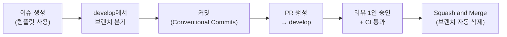

# 협업 가이드

> [← 조직 홈](https://github.com/Junseung0526) · [아키텍처](docs/ARCHITECTURE.md) · [기능 명세](docs/FEATURES.md) · [로드맵](docs/ROADMAP.md)

## 0. 팀 역할

<!-- 한 사람이 여러 역할을 맡아도 됩니다. 담당 업무는 "무엇을 끝내면 되는지"가 보이게 씁니다. -->
| 이름 | 역할 | 담당 업무 |
| :--- | :---: | :--- |
| **팀원 1** | **PM** | • 일정·요구사항 관리<br>• 사용자 인터뷰, 발표 총괄 |
| **팀원 2** | **Design** | • 화면 흐름·와이어프레임<br>• 디자인 시스템, 컴포넌트 표준화 |
| **팀원 3** | **Frontend** | • 주요 화면 구현<br>• API 연동, 예외 처리 화면 |
| **팀원 4** | **Backend** | • 도메인·DB 설계<br>• REST API, 배포 |

---

## 작업 흐름



## 1. 브랜치 및 커밋 규칙

### 브랜치 전략
- 기본 브랜치는 `main` (배포)과 `develop` (개발 통합)입니다.
- 모든 작업은 `develop`에서 분기하고 PR로 병합합니다.
- **해커톤 등 단기 프로젝트**는 `develop` 없이 `main`에서 바로 분기해도 됩니다.
- **브랜치 이름**: `<prefix>/<작업명>` (소문자, 하이픈 `-` 사용)

| Prefix | 사용 목적 | 예시 |
| :--- | :--- | :--- |
| `feat` | 새로운 기능 | `feat/login`, `feat/file-upload` |
| `fix` | 버그 수정 | `fix/date-format`, `fix/null-response` |
| `docs` | 문서 | `docs/readme`, `docs/api-guide` |
| `refactor` | 리팩토링 (기능 변경 없음) | `refactor/user-service` |
| `test` | 테스트 | `test/e2e-scenarios` |
| `chore` | 빌드·설정·패키지 | `chore/update-dependencies` |

---

### 커밋 메시지 규칙

**Conventional Commits**를 따르고, 본문에 **왜**와 **어떻게**를 적습니다.

#### 1. 기본 구조
```gitcommit
<type>: <작업 요약 (50자 이내)>

## 변경 이유
- 어떤 문제를 해결하려 했는지, 어떤 요구사항 때문인지

## 변경 내용
- 무엇을 어떻게 바꿨는지, 부수 효과나 마이그레이션이 있다면 함께

Resolves: #이슈번호 (선택)
```

#### 2. 커밋 타입
- `feat`: 새로운 기능
- `fix`: 버그 수정
- `docs`: 문서
- `style`: 포맷팅 (로직 변경 없음)
- `refactor`: 리팩토링 (기능 추가·버그 수정 없음)
- `test`: 테스트 추가·수정
- `chore`: 빌드, 패키지, `.gitignore` 등 기타

#### 3. 좋은 예시
```gitcommit
feat: 회원가입 시 이메일 중복 검사 추가

## 변경 이유
- 같은 이메일로 여러 계정이 만들어져 비밀번호 찾기가 실패하는 문제

## 변경 내용
- 가입 API에서 이메일을 소문자로 정규화한 뒤 중복 여부 검사
- 중복이면 409와 안내 메시지 반환, DB에 unique 제약 추가

Resolves: #12
```

#### 4. 피해야 할 예시
- `fix: 수정` — 무엇을 왜 고쳤는지 알 수 없음
- `feat: 기능 추가함` — 추적 불가
- `update: main.py` — 타입 규칙 위반, 이유 누락

---

## 2. PR 규칙

### PR 제목
`[<Type>] <작업 요약>` 형태로 씁니다.
- 예시: `[Feat] 파일 업로드 및 진행률 표시 구현`
- 예시: `[Fix] 날짜 필터 타임존 오류 수정`

### PR 본문
PR을 만들면 [PULL_REQUEST_TEMPLATE.md](.github/PULL_REQUEST_TEMPLATE.md)가 자동으로 채워집니다.

### 리뷰 및 머지
1. **1인 이상 승인** 후 머지합니다. (해커톤에서는 셀프 머지 허용 가능)
2. **CI 통과 필수**: 린트와 테스트가 성공해야 합니다.
3. **Squash and Merge**로 히스토리를 정돈합니다.
4. 머지된 브랜치는 바로 삭제합니다.

---

## 3. 로컬 개발 환경

<!-- 실제 스택으로 바꾸세요. 레포별 상세 실행 방법은 각 레포 README에 적습니다. -->

### 요구 환경
- Node.js 20+
- (백엔드 언어·런타임 버전)
- (DB 종류·버전)

### 프론트엔드
```bash
npm install
npm run dev
```

### 백엔드
```bash
# 예: 의존성 설치 → 마이그레이션 → 서버 실행
```

---

## 4. 주의
- 비밀번호, API 키, 개인정보는 커밋·이슈·PR·스크린샷에 올리지 않습니다. 테스트에는 가짜 데이터만 씁니다.
- `.env`와 실제 데이터 파일은 `.gitignore`로 제외합니다.
