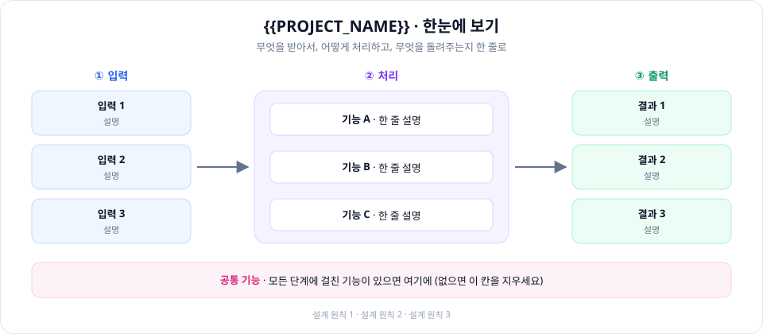
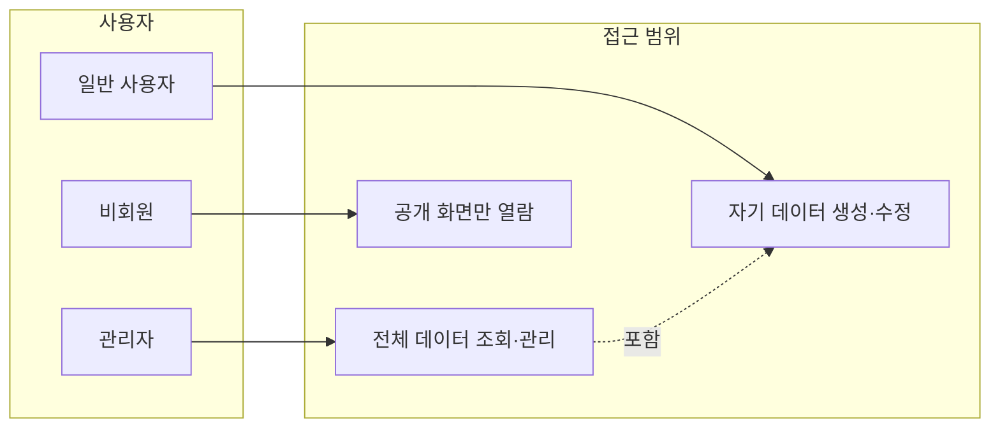
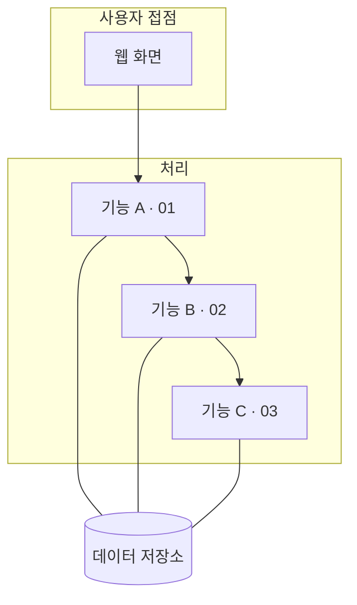
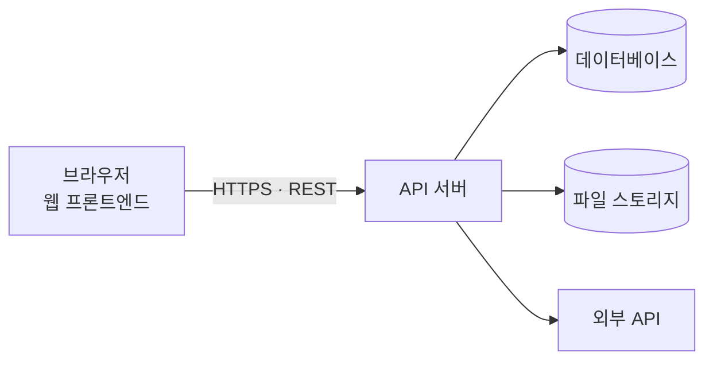
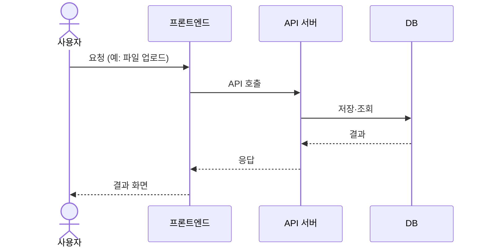
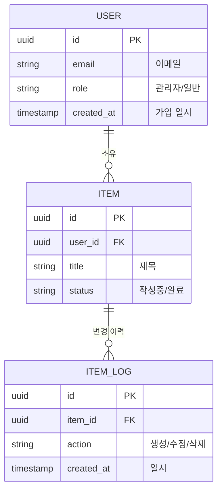

# 시스템 아키텍처

> [← 조직 홈](https://github.com/{{ORG}}) · [아키텍처](ARCHITECTURE.md) · [기능 명세](FEATURES.md) · [로드맵](ROADMAP.md) · [협업 가이드](../CONTRIBUTING.md)

> **문서 상태**: 구현 기준 설계. 구조나 [기술 스택](#7-기술-스택)이 바뀌면 코드보다 이 문서를 먼저 갱신합니다.

## 목차
1. [한눈에 보기](#1-한눈에-보기)
2. [설계 원칙](#2-설계-원칙)
3. [사용자와 권한](#3-사용자와-권한)
4. [모듈 구성](#4-모듈-구성)
5. [시스템 구성도](#5-시스템-구성도)
6. [데이터 모델](#6-데이터-모델)
7. [기술 스택](#7-기술-스택)
8. [보안 및 데이터 관리](#8-보안-및-데이터-관리)
9. [전제 (가정)](#9-전제-가정)

---

## 1. 한눈에 보기

<!-- 무엇을 받아서(입력) 무엇을 하고(처리) 무엇을 내보내는지(출력) 두 문장으로. -->
사용자가 **무엇을** 넣으면 시스템이 **어떤 처리**를 거쳐 **어떤 결과**를 돌려주는지 두 문장으로 적습니다.

---

## 2. 설계 원칙

<!-- 팀이 의견 충돌할 때 판단 기준이 되는 원칙 3~5개. 위에 있을수록 우선. -->
모든 설계 결정은 아래 원칙을 따릅니다. 충돌하면 위에 있는 원칙이 우선합니다.

| # | 원칙 | 의미 | 적용 예 |
| :---: | :--- | :--- | :--- |
| 1 | **보안 우선** | 민감 정보는 암호화 저장, 화면에는 마스킹 | 비밀번호 해시, 전화번호 마스킹 |
| 2 | **단순함** | 지금 필요한 것만 만든다 | MVP 밖 기능은 로드맵으로 |
| 3 | **추적 가능성** | 모든 결과는 원본 입력까지 거슬러 올라갈 수 있다 | 오류 클릭 → 원본 위치 |

---

## 3. 사용자와 권한

| 역할 | 할 수 있는 일 | 할 수 없는 일 |
| :--- | :--- | :--- |
| **관리자** | 전체 조회, 권한 부여, 설정 관리 | — |
| **일반 사용자** | 자기 데이터 생성·수정·삭제 | 다른 사용자 데이터 접근 (서버에서 403) |
| **비회원** | 공개 화면 열람 | 쓰기 작업 전부 |

---

## 4. 모듈 구성

기능 번호는 [FEATURES.md](FEATURES.md)의 번호와 같습니다.

| 모듈 | 책임 | 입력 | 출력 | 기능 |
| :--- | :--- | :--- | :--- | :--- |
| 기능 A | 무엇을 책임지는지 | 입력 데이터 | 결과 데이터 | 01 |
| 기능 B | 무엇을 책임지는지 | 입력 데이터 | 결과 데이터 | 02 |
| 기능 C | 무엇을 책임지는지 | 입력 데이터 | 결과 데이터 | 03 |

---

## 5. 시스템 구성도

<!-- 실제 구성에 맞게 노드를 고치세요. 큐·워커·외부 API가 없으면 지웁니다. -->

| 구성 요소 | 역할 / 왜 분리하나 |
| :--- | :--- |
| API 서버 | 인증·권한 검사와 비즈니스 로직을 한 곳에서 처리 |
| 데이터베이스 | 업무 데이터 영구 저장 |
| 파일 스토리지 | 업로드 파일을 DB와 분리해 접근 제한 |
| 외부 API | (사용하는 외부 서비스와 용도) |

### 핵심 흐름

<!-- 가장 중요한 사용 시나리오 하나를 시퀀스로. 필요하면 7.1, 7.2처럼 더 추가. -->

---

## 6. 데이터 모델

| 도메인 | 핵심 엔티티 | 메모 |
| :--- | :--- | :--- |
| 사용자 | `USER` | 역할로 권한 구분 |
| 업무 | `ITEM` | 프로젝트의 핵심 데이터로 이름을 바꾸세요 |
| 이력 | `ITEM_LOG` | 누가 언제 무엇을 바꿨는지 |

---

## 7. 기술 스택

| 영역 | 스택 | 고른 이유 |
| :--- | :--- | :--- |
| 프론트엔드 | (예: React + TypeScript) | |
| 백엔드 | (예: Spring Boot / Django / Express) | |
| 데이터베이스 | (예: PostgreSQL) | |
| 배포 | (예: Vercel + AWS) | |

---

## 8. 보안 및 데이터 관리

| 영역 | 규칙 |
| :--- | :--- |
| 접근 제어 | 역할·소유 범위를 **서버에서** 검사. 범위 밖 요청은 403 |
| 민감 정보 | 비밀번호는 해시, 키·토큰은 환경 변수로 코드와 분리 |
| 감사 로그 | 중요한 수정에 수정자·일시·변경 전/후 값 기록 |
| 개발 | 실제 개인정보는 저장소에 올리지 않음. 테스트는 가짜 데이터 |

---

## 9. 전제 (가정)

<!-- 이 가정이 깨지면 설계를 다시 봐야 하는 것들. 데이터 확보, 외부 API 사용 가능 여부 등. -->
아래 가정이 깨지면 해당 부분을 다시 설계합니다.

| # | 가정 | 영향 받는 부분 |
| :---: | :--- | :--- |
| A1 | 기간 안에 MVP 기능(01~03)을 구현할 수 있다 | 전체, [로드맵](ROADMAP.md) |
| A2 | 필요한 샘플 데이터를 확보한다 | 01 |
| A3 | 사용할 외부 API를 쓸 수 있다 | 02 |
